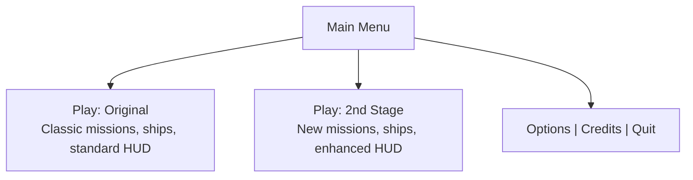
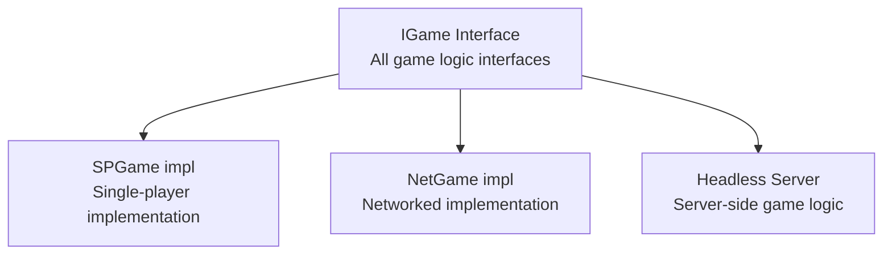
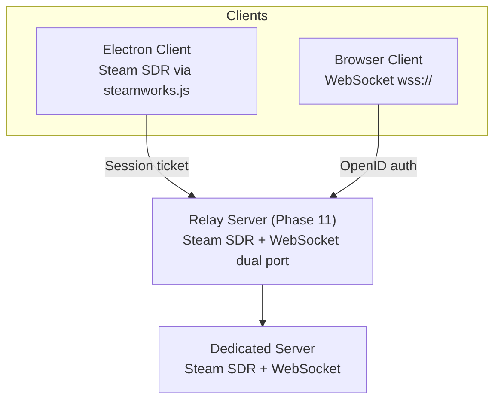
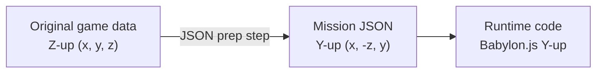
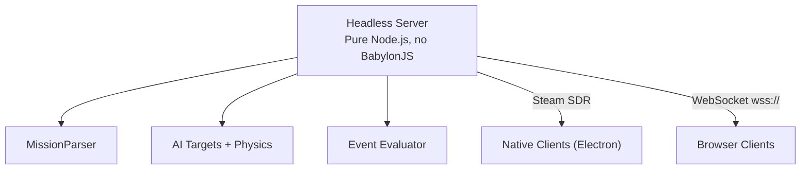
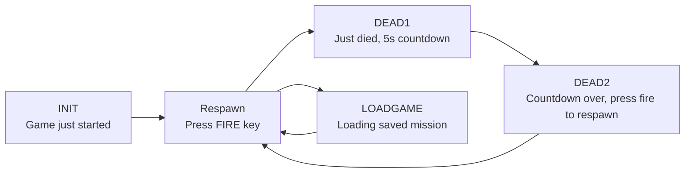
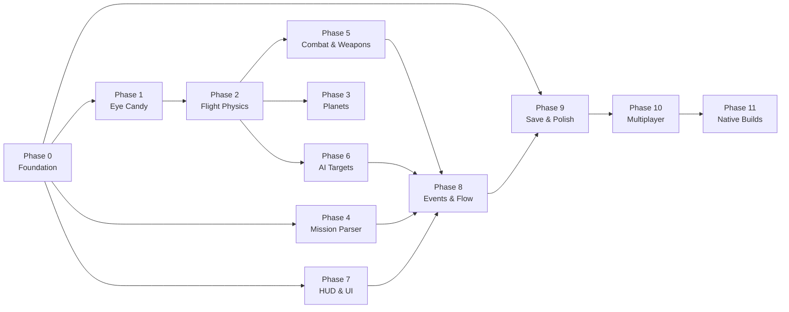

# ORBIT: SECOND STAGE — Implementation Plan

> An inspired re-creation of the classic Orbit space combat simulator. Built with Babylon.js / TypeScript / Vite. Not a port of the original C code — a fresh implementation of the core game mechanics, with no copyrighted material from the 1999 original.
> Architecture-first approach: multiplayer-ready from day one, Electron support early, high code coverage from the start.

---

## Table of Contents

1. [Overview & Key Architectural Decisions](#1-overview--key-architectural-decisions)
2. [Architecture Principles](#2-architecture-principles)
3. [Project Structure](#3-project-structure)
4. [Build & Test Infrastructure](#4-build--test-infrastructure)
5. [Types](#5-types)
6. [Files](#6-files)
7. [Functions](#7-functions)
8. [Classes](#8-classes)
9. [Constants, Definitions & Game Data](#9-constants-definitions--game-data)
10. [Dependencies](#10-dependencies)
11. [Testing Strategy](#11-testing-strategy)
12. [Implementation Order — Phases 0–12](#12-implementation-order--phases-012)
13. [Risk Register](#13-risk-register)
14. [Phase Dependencies](#14-phase-dependencies)

---

## 1. Overview & Key Architectural Decisions

This document defines the step-by-step implementation of **Orbit: Second Stage**, a Babylon.js / TypeScript / Vite space combat simulator. The project is an inspired re-creation of the 1999 freeware game *Orbit* by Steve Belczyk — not a port, but a fresh implementation using modern web technologies.

**What this means in practice:** You are building a space combat game from scratch that feels like the original Orbit, but uses modern tools (Babylon.js for 3D rendering, TypeScript for type safety, Vite for fast builds). The game runs in browsers and as native desktop apps via Electron. Multiplayer support is designed into the architecture from day one, even though the first playable build focuses on single-player.

The first playable build recreates the Original Orbit experience (flight, combat, missions, solar system). Second Stage content (new missions, ships, weapons, story) is added incrementally after the core engine is solid.

### Key Architectural Decisions

| Decision | Rationale |
|----------|------------|
| **Babylon.js full** (not Lite) | WebXR support requires the full module set; Lite strips it out |
| **Y-up world coordinate system** | Babylon.js native Y-up — we use `@babylonjs/core/Maths` (Vector3, Matrix4) directly throughout; Z-up data from the original game is converted to Y-up during mission JSON generation as a prep step |
| **JSON mission files** replacing the original text-based `.msn` format | Enables web serving, future mission editor tooling, and easier parsing |
| **Interface-segregated architecture** | Every game system has an `I*` interface with single-player and network variants from day one, even if network implementations are stubs initially |
| **Electron as native target** | Mature `steamworks.js` integration, established IPC patterns for Babylon.js ↔ Steam SDK bridge |
| **Placeholders first** | Colored spheres, boxes, and basic geometries for early phases; real GLTF models swapped in later |
| **Multiplayer-ready from day one** | Interfaces designed for networked play, but implementations deferred to Phase 10 |
| **Deterministic physics** | Fixed-timestep accumulator pattern (1/60s tick) — reproducible across platforms, essential for netcode later |
| **Babylon.js for math and rendering** | `@babylonjs/core/Maths` (Vector3, Matrix4) used throughout — tree-shaken to minimal bundle; Babylon.js only for rendering/input; everything else is pure TypeScript — easy to test in Node, run headless server |

### How to Read This Document

Think of this as your assignment brief. Each section has a purpose:

- **Sections 1–4** tell you *how* the project is organized and *why* decisions were made.
- **Sections 5–9** are reference material — the types, files, functions, classes, and constants you will implement. You don't need to memorize these; they're here so you always know what needs to exist.
- **Section 12** is your task list — broken into phases with clear deliverables and tests.
- **Sections 10, 11, 13–14** cover dependencies, testing, risks, and phase ordering.

---

## 2. Architecture Principles

### 2.1 Dual Game Modes

Orbit: Second Stage ships with two playable modes:

| Mode | Description | Scope | Story Context |
|------|-------------|-------|---------------|
| **Original Orbit** | Faithful recreation of the 1999 game mechanics | Core gameplay loop: flight, combat, missions, solar system exploration | The events of the original Orbit — you are the pilot defending the solar system |
| **Second Stage** | Your additional features, ships, weapons, and story content | Layers on top of Original — unlocks after completing core content | Set after the events of the original — new threats, new tech, expanded universe |

Both modes share the same core game engine, physics, and systems. Mode selection determines which mission sets, ships, weapons, and HUD elements are available. Second Stage missions can reference Original content (existing planets, stations) as part of the story. Save system tracks progress per mode independently.



**Mission file organization:**

```
data/missions/
├── original/              # Classic Orbit missions
│   ├── train01.msn
│   ├── combat01.msn
│   └── ...
└── second-stage/          # Expansion missions (unlocked after story progression)
    ├── ss01-intro.msn
    ├── ss02-escalation.msn
    └── ...
```

### 2.2 Interface-Segregated Architecture (The `I*` Pattern)

Every game system follows the same pattern: define an interface first, then implement it for single-player and multiplayer separately.

Here's how it works in practice:



Every game system follows this pattern:

- `IWeaponSystem` → `SinglePlayerWeaponSystem` + `NetworkedWeaponSystem`
- `IAIManager` → `SinglePlayerAIManager` + `ServerAIManager` (server-side AI)
- `IPlayerController` → `KeyboardPlayerController` + `JoystickPlayerController` + `NetworkPlayerProxy`

**Why this matters:** When you implement a system, start by defining the interface. Then write the single-player version first (it's simpler). The network version just wraps the SP version with serialization/deserialization. This means you get working single-player early, and the multiplayer code is straightforward to add later.

### 2.3 Hybrid Network Architecture

**Critical: Browser and native clients use different transport layers.**



**Platform-specific networking:**

| Platform | Transport | Auth | Features |
|----------|-----------|------|----------|
| **Electron** | Steam SDR via `steamworks.js` | Session ticket | Lobbies, overlay, matchmaking, NAT punch |
| **Browser** | WebSocket (`wss://`) to relay | OpenID 2.0 → Web API | Server-verified ownership, no Steam overlay |
| **Dedicated Server** | Steam SDR + WebSocket dual port | GSLT | Master Server registration, bridges both worlds |

**Authentication flow (browser clients):**
1. Browser → Steam OpenID 2.0 (`steamcommunity.com/openid/login`)
2. Steam returns verified `SteamID64` to server
3. Server calls `ISteamUser/CheckAppOwnership` with Publisher Key
4. If owned, grant access; otherwise reject

**Server discovery (browser clients):**
- Server queries `IGameServersService/GetServerList` via Steam Web API
- Returns JSON list of active server IPs/ports to browser clients
- Browser connects directly via WebSocket to selected server

### 2.4 Coordinate System

The game world uses **Y-up** — Babylon.js native coordinate system. All position/orientation data is stored in Y-up throughout the runtime codebase. We use `@babylonjs/core/Maths` (`Vector3`, `Matrix4`) directly for all vector and matrix operations.

Any Z-up data from the original game's documentation or specs is converted to Y-up during mission JSON generation as a prep step. The conversion formula: `(x, y, z)_Zup → (x, -z, y)_Yup`. This happens once when building mission files — never at runtime.



> **Rule:** No custom Vector3/Matrix4 implementations. Use `BABYLON.Vector3` and `BABYLON.Matrix` from `@babylonjs/core/Maths` everywhere — client, server, tests. Tree-shaking ensures minimal bundle impact.

### 2.5 Save System — Strict Separation

| Scenario | Where Saves Are Stored | Can Upload to Server? | Can Download from Server? |
| ---------------------------- | ------------------------------------------------- | --------------------- | ------------------------- |
| **Single-player (web)** | Browser IndexedDB | ❌ No | ❌ No |
| **Single-player (Electron)** | Local filesystem (`~/.orbit-second-stage/saves/`) | ❌ No | ❌ No |
| **Multiplayer session** | Server-side file only | N/A | N/A |

Prevents save manipulation via server interaction. Keeps architecture simple — no sync complexity.

### 2.6 Mission Events — Triggers and Actions

This section explains how mission events work, since the original game used them extensively and you'll need to implement them.

**What is an Event?** An event is a rule that says "when X happens, do Y." It's the core mechanism for mission progression. Events are defined in mission files and evaluated every frame during gameplay.

An event has two parts:

1. **Trigger** — The condition that must become true. Examples:
   - `Approach` — Player gets within a certain distance of an object
   - `Depart` — Player moves beyond a certain distance from an object
   - `True` — Always true (fires immediately when the mission loads)
   - `Score` — Player's score reaches a threshold
   - `Destroy` — A specific target is destroyed
   - `Alarm` — The player fires a weapon

2. **Action** — What happens when the trigger fires. Examples:
   - `Message` — Display text to the player (briefing, warning, etc.)
   - `Hide` / `Unhide` — Make an object visible or invisible
   - `Destroy` — Destroy a target immediately
   - `Score` — Award points to the player
   - `Enable` / `Disable` — Enable or disable another event
   - `LoadMission` — Load the next mission in a chain
   - `Boom` — Create an explosion effect
   - `Flash` — Screen flash effect

**How it works in code:**

```
Every game tick:
  For each active event:
    1. Evaluate the trigger (is the condition true?)
    2. If yes and the event hasn't fired yet:
       - Execute the action
       - Mark event as fired (most events fire once)
    3. If the event is re-triggerable, check if it should fire again
```

Events are parsed from mission files during Phase 4 (Mission Parser) and evaluated in Phase 8 (Events & Game Flow). The `EventEvaluator` class checks triggers, and the `ActionProcessor` class executes actions.

### 2.7 Fixed-Timestep Physics

The game uses a fixed-timestep accumulator pattern for physics. This means:

- Physics updates happen at a fixed rate: 60 times per second (1/60s per tick)
- Rendering can happen at any frame rate (30fps, 60fps, 144fps, whatever the hardware supports)
- The accumulator pattern ensures physics is deterministic and reproducible

**How it works:**

```
Game loop:
  accumulator += elapsed_time_since_last_frame
  while accumulator >= fixed_delta_t (1/60):
    physics_update(1/60)   // Deterministic, fixed step
    accumulator -= fixed_delta_t
  render(interpolation_factor = accumulator / fixed_delta_t)
```

The interpolation factor tells the renderer how far between two physics ticks we are, so objects appear smooth even when rendering at higher frame rates than physics updates.

> **Why this matters for multiplayer:** Deterministic physics means every client sees the same game state. This is essential for netcode — without it, different clients would diverge and you'd get desync issues.

---

## 3. Project Structure

The project follows a modular structure where each game system lives in its own directory under `src/`. Here's the full layout:

```txt
orbit-second-stage/
├── design/                    # Architecture docs, implementation plan
│   └── implementation_plan_consolidated.md  # This file
├── src/
│   ├── index.ts               # Web entry point (boot Babylon.js scene)
│   ├── main.ts                # Node/desktop entry point
│   │
│   ├── core/                  # Foundation — no game logic (uses @babylonjs/core/Maths for Vector3/Matrix4)
│   │   ├── Timer.ts           # Fixed-timestep accumulator
│   │   ├── EventBus.ts        # Event system (pub/sub)
│   │   ├── RNG.ts             # Seeded PRNG (Mulberry32)
│   │   ├── Logger.ts          # Structured logging
│   │   └── game-mode.ts       # GameMode enum + mode selector
│   │
│   ├── player/                # Player ship system
│   │   ├── IShip.ts           # Ship interface
│   │   ├── Ship.ts            # Core ship state (SP)
│   │   ├── FlightModel.ts     # Newtonian / Arcade models
│   │   ├── Camera.ts          # Babylon.js camera wrapper
│   │   └── InputManager.ts    # Keyboard + joystick abstraction
│   │
│   ├── weapons/               # Weapon system
│   │   ├── IWeaponSystem.ts
│   │   ├── SinglePlayerWeaponSystem.ts
│   │   ├── NetworkedWeaponSystem.ts
│   │   ├── WeaponDef.ts       # Weapon definitions (from missions)
│   │   ├── Missile.ts         # Missile entity
│   │   └── MissilePool.ts     # Object pool for missiles
│   │
│   ├── targets/               # AI target system
│   │   ├── ITargetManager.ts
│   │   ├── SinglePlayerAIManager.ts
│   │   ├── NetworkedAIManager.ts
│   │   ├── Target.ts          # Target entity state
│   │   ├── Strategy.ts        # Strategy enum + registry
│   │   ├── TurnToward.ts      # AI: rotate toward target
│   │   ├── MoveToward.ts      # AI: translate toward target
│   │   ├── FindEnemy.ts       # AI: closest-target search
│   │   └── Aim.ts             # AI: predictive aiming
│   │
│   ├── planets/               # Solar system
│   │   ├── ISolarSystem.ts
│   │   ├── SolarSystem.ts     # SP implementation
│   │   ├── Planet.ts          # Planet entity
│   │   ├── RingSystem.ts      # Planetary rings
│   │   └── Starfield.ts       # 65K+ star rendering
│   │
│   ├── missions/              # Mission parsing & execution
│   │   ├── IMissionParser.ts
│   │   ├── MissionParser.ts   # Tokenizer + brace parser
│   │   ├── Mission.ts         # Parsed mission data
│   │   ├── Event.ts           # Event entity
│   │   ├── Trigger.ts         # Trigger types enum
│   │   ├── Action.ts          # Action types enum
│   │   ├── EventHandler.ts    # Event evaluation engine
│   │   └── cursor/            # Cursor management
│   │       └── CursorStack.ts
│   │
│   ├── hud/                   # HUD rendering
│   │   ├── IHUD.ts
│   │   ├── SinglePlayerHUD.ts
│   │   ├── Radar.ts           # Circular radar overlay
│   │   ├── ShieldBar.ts       # Shield status bars
│   │   ├── Crosshair.ts       # Center crosshair
│   │   └── MessageOverlay.ts  # Briefing / console messages
│   │
│   ├── effects/               # Visual/audio effects
│   │   ├── Explosion.ts       # Icosahedron explosion
│   │   ├── ExplosionPool.ts   # Object pool
│   │   ├── SpaceJunk.ts       # Motion reference polygons
│   │   └── SoundManager.ts    # Audio abstraction
│   │
│   ├── save/                  # Save system
│   │   ├── ISaveManager.ts
│   │   ├── SaveManager.ts     # SP save/load
│   │   └── SaveEntry.ts       # Save data structure
│   │
│   ├── network/               # Multiplayer layer (interfaces + impls)
│   │   ├── INetworkLayer.ts   # Network interface
│   │   ├── SPNetworkLayer.ts  # No-op for SP mode
│   │   ├── SteamNetwork.ts    # Native multiplayer (Steam SDR via steamworks.js)
│   │   ├── WebSocketNetwork.ts# Browser multiplayer (wss:// to relay server)
│   │   ├── NetworkBridge.ts   # Protocol translation: Steam SDR ↔ WebSocket
│   │   ├── Packet.ts          # Packet format definitions
│   │   └── Server.ts          # Headless dedicated server (Steam SDR + WebSocket)
│   │
│   └── game/                  # Game orchestration
│       ├── IGame.ts           # Core game interface
│       ├── SinglePlayerGame.ts
│       ├── NetworkedGame.ts   # Client-side networked game
│       ├── GameState.ts       # State machine (enum)
│       └── GameFactory.ts     # Creates correct game mode
│
├── electron/                  # Electron app
│   ├── main.js                # Electron main process
│   ├── preload.js             # Security bridge
│   └── package.json           # Electron-specific deps
│
├── tests/                     # Test suite (mirrors src/ structure)
│   ├── core/
│   │   ├── timer.test.ts
│   │   ├── event-bus.test.ts
│   │   ├── rng.test.ts
│   │   └── logger.test.ts
│   ├── player/
│   │   ├── flight-model.test.ts
│   │   └── ship.test.ts
│   ├── weapons/
│   │   ├── weapon-defs.test.ts
│   │   └── missile-pool.test.ts
│   ├── targets/
│   │   ├── strategy.test.ts
│   │   ├── turn-toward.test.ts
│   │   ├── move-toward.test.ts
│   │   ├── find-enemy.test.ts
│   │   └── aim.test.ts
│   ├── planets/
│   │   └── solar-system.test.ts
│   ├── missions/
│   │   ├── parser.test.ts           # Tokenizer + brace parsing
│   │   ├── cursor-stack.test.ts
│   │   ├── event-evaluator.test.ts
│   │   └── action-processor.test.ts
│   ├── effects/
│   │   └── explosion.test.ts
│   ├── save/
│   │   └── save-manager.test.ts
│   ├── network/
│   │   ├── packet.test.ts
│   │   └── server.test.ts
│   └── integration/
│       ├── mission-load.test.ts     # Full mission load → state check
│       └── combat-flow.test.ts      # Fire missile → hit → damage
│
├── data/                    # Game assets (all original, no licensing concerns)
│   ├── missions/            # JSON mission files (converted from .msn)
│   ├── models/              # Original ship/station/starfield GLTF/GLB models
│   ├── textures/            # Planet/space/background PNG/WebP textures
│   ├── sounds/              # Original SFX (explosions, engines, weapons)
│   └── music/               # Original background music tracks
│
├── dist/                    # Build output
├── coverage/                # Vitest coverage reports
├── docs/                    # Developer documentation
├── package.json
├── tsconfig.json
├── tsconfig.test.json
├── vite.config.ts
├── vitest.config.ts
├── eslint.config.js
├── .prettierrc.js
└── .gitignore
```

### How the Directories Relate to Each Other

- **`src/core/`** — The foundation. These modules have no dependencies on game logic. They are pure utilities: timers, event buses, random number generators, loggers. You'll build these first in Phase 0.
- **`src/player/`** — The player's ship and how it moves. Depends on core (Timer, RNG). Implements IShip interface.
- **`src/weapons/`** — Missiles and weapon definitions. Depends on core and player.
- **`src/targets/`** — AI targets that fight back. Depends on player (for position/velocity data).
- **`src/planets/`** — The solar system: planets, moons, rings, starfield. Depends on core.
- **`src/missions/`** — Mission parsing and event handling. This is where mission files are read and events are evaluated.
- **`src/hud/`** — All on-screen UI elements: radar, shield bars, crosshair, messages.
- **`src/effects/`** — Visual effects (explosions) and audio.
- **`src/save/`** — Save/load system. Strictly separated from network saves.
- **`src/network/`** — Multiplayer layer. Interfaces defined early, implementations added in Phase 10+.
- **`src/game/`** — The top-level game orchestrator that ties everything together.

---

## 4. Build & Test Infrastructure

### 4.1 Package.json Scripts

```json
{
  "scripts": {
    "dev": "vite --open",
    "build": "tsc && vite build",
    "build:electron": "npm run build && cd electron && npm run build",
    "preview": "vite preview",
    "test": "vitest",
    "test:run": "vitest run",
    "test:coverage": "vitest run --coverage",
    "test:watch": "vitest watch",
    "clean": "rm -rf dist coverage",
    "lint": "eslint src/**/*.ts tests/**/*.ts",
    "lint:fix": "eslint src/**/*.ts tests/**/*.ts --fix",
    "format": "prettier --write src/**/*.ts tests/**/*.ts",
    "docs": "npx typedoc",
    "server:start": "node dist/network/Server.js",
    "electron:start": "npm run build && cd electron && npm start"
  }
}
```

### 4.2 Vitest Configuration

```typescript
// vitest.config.ts
import { defineConfig } from 'vitest/config'

export default defineConfig({
  test: {
    coverage: {
      enabled: true,
      reporter: ['text', 'lcov'],
      include: ['src/**/*'],
      exclude: ['src/index.ts', 'src/main.ts'],
      lines: 90,
      branches: 85,
      functions: 90,
      statements: 90
    },
    environment: 'node',
    globals: true,
    testMatch: ['tests/**/*.test.ts']
  }
})
```

### 4.3 Coverage Thresholds (Project Standard)

| Metric | Threshold | Notes |
| ---------- | --------- | -------------------------------------------------- |
| Lines | 90% | Core domain logic must be thoroughly tested |
| Branches | 85% | AI strategies, event evaluation have many branches |
| Functions | 90% | Every public method must be called in tests |
| Statements | 90% | Consistent with line coverage |

> **What "90% coverage" means:** For every 10 lines of code, at least 9 must be executed during tests. This is strict — you can't skip edge cases. If a function has an `if (x > 0) { ... } else { ... }` branch, both branches must be tested.

### 4.4 Headless Dedicated Server

The server is a pure Node.js process with no rendering dependencies. It runs the same game logic as the client but without any Babylon.js rendering code.



**Files:**
- `src/network/Server.ts` — Pure Node.js server, no DOM required
- `src/network/NetworkBridge.ts` — Protocol translation layer
- Server initializes Steamworks SDK (`SteamGameServer_Init`) for Master Server registration + GSLT auth

> **Important note for the server:** The server uses `@babylonjs/core/Maths` for Vector3 and Matrix operations (via tree-shaking, this adds negligible bundle size). This ensures the server's physics calculations produce identical results to the client. Without shared math primitives, you'd get subtle differences between client and server positions.

---

## 5. Types

This section defines all the TypeScript types used throughout the project. Think of this as your API reference — if you need to know what a function returns or what properties an object has, look here.

### Core Types

```typescript
// Babylon.js math — used throughout (client + server + tests)
// import { Vector3, Matrix } from '@babylonjs/core/Maths'

// src/core/RNG.ts
type RNGState = { seed: number };

// src/core/Logger.ts
enum LogLevel { DEBUG = 0, INFO = 1, WARN = 2, ERROR = 3 }
interface LogEntry { level: LogLevel; message: string; timestamp: number; context?: Record<string, unknown> }

// src/core/Timer.ts
interface TimerState {
  accumulator: number;
  fixedDeltaT: number; // typically 1/60
  interpolationFactor: number; // 0..1 for rendering between ticks
}

// src/core/EventBus.ts
type EventHandler<T> = (data: T) => void;
```

### Game Types

```typescript
// src/game/GameState.ts
enum GameState { MENU, BRIEFING, PLAYING, PAUSED, DEAD1, DEAD2, VICTORY, DEFEAT, LOADGAME }

// src/player/Ship.ts
enum ShipState { INIT, NORMAL, DEAD1, DEAD2, LOADGAME }

// src/targets/Strategy.ts
enum AIFStrategy {
  DO_NOTHING = 0, SIT1 = 1, SIT2 = 2, SIT3 = 3, SIT4 = 4,
  HUNT1 = 5, HUNT2 = 6, HUNT3 = 7, HUNT4 = 8,
}

interface ShipStateData {
  position: BABYLON.Vector3; velocity: BABYLON.Vector3; viewDir: BABYLON.Vector3;
  upDir: BABYLON.Vector3; rightDir: BABYLON.Vector3;
  shields: number; maxShields: number; score: number; selectedWeapon: number;
  flightModel: 'newtonian' | 'arcade'; state: ShipState; deathTimer: number;
}

// src/player/FlightModel.ts
interface FlightModelConfig {
  deltax: number; warpCoeff: number; maxThrottle: number; maxWarpThrottle: number; thetaRate: number;
}

interface FlightModelState {
  thrust: number;       // Current throttle (0..1)
  warpActive: boolean;
  lastFireTime: number; // Cooldown tracking
}

// src/weapons/Missile.ts
enum MissileState { ACTIVE, EXPIRED, HIT }
interface MissileStateData {
  position: BABYLON.Vector3; velocity: BABYLON.Vector3;
  weaponDefIndex: number; owner: string; age: number;
  state: MissileState; alive: boolean;
}

// src/targets/Target.ts
enum TargetFaction { ENEMY, FRIENDLY, NEUTRAL }
interface TargetStateData {
  name: string; position: BABYLON.Vector3; velocity: BABYLON.Vector3;
  viewDir: BABYLON.Vector3; strategy: Strategy; faction: TargetFaction;
  shields: number; maxShields: number; weaponIndex: number;
  score: number; hidden: boolean; model: string;
}

// src/planets/Planet.ts
interface PlanetStateData {
  name: string; position: BABYLON.Vector3; velocity: BABYLON.Vector3;
  radius: number; mass: number; color: [number, number, number];
  texturePath?: string; isMoon: boolean; primary: PlanetStateData | null;
  hidden: boolean; theta: number; // Orbital angle
}

// src/missions/Mission.ts
interface MissionData {
  name: string; briefing: string[];
  playerStart: { position: BABYLON.Vector3; model: string; name: string };
  targets: TargetDef[]; events: EventDef[];
  waypoints: BABYLON.Vector3[];
}

interface TargetDef {
  name: string; model: string; score: number; strategy: Strategy;
  friendly: boolean; hidden: boolean; weaponIndex: number;
  maxShields: number; turnRate: number; speed: number;
  position: BABYLON.Vector3;
}

interface EventDef {
  name?: string; trigger: Trigger; triggerValue: number | string;
  enabled: boolean; action: Action; actionValue: number | string;
}

// src/missions/Mission.ts — detailed mission file types
interface CursorDef { name: string; offsetX?: number; offsetY?: number; offsetZ?: number; refPlanet?: string }
interface PlayerDef { name: string; position: [number, number, number]; velocity?: [number, number, number] }
interface WaypointDef { name: string }
interface PlanetModDef { name: string; newName?: string; reposition?: boolean; hidden?: boolean; texture?: string; oblicity?: number; radius?: number }

// src/hud/MessageOverlay.ts
enum MessageType { BRIEFING = 'briefing', CONSOLE = 'console', EVENT = 'event' }
interface MessageEntry {
  text: string; type: MessageType; timestamp: number; visible: boolean;
}
```

### Network Types

```typescript
// src/network/Packet.ts
enum PacketType {
  POSS = 0x80,   // Short position report
  POSL = 0x81,   // Long position report
  POSU = 0x82,   // Urgent position report
  POSN = 0x83,   // Regular position report
  PLAN = 0x84,   // Planet position data
  VCNT = 0x85,   // Vacancy report
  PING = 0x86,   // Latency ping
}

interface IPacket {
  magic: 0x56;
  type: PacketType;
  size: number;
  data: Uint8Array;
}

type ASCIICommand = 
  | `FIRE ${string}`
  | `CHAT ${string}`
  | `CMSG ${string}: ${string}`
  | `DROP ${string}`
  | `NAME ${string}`;
```

---

## 6. Files

This section lists every source file and what it does. Use this as a checklist — when you finish implementing a file, check it off mentally.

### Existing Files (Foundation — Phase 0)

| File | Purpose |
| ----------------------- | ---------------------------------------------------------------------------------------------- |
| `src/core/Timer.ts`     | Fixed-timestep accumulator: tick(), getDeltaT(), getAccumulator(), reset() |
| `src/core/EventBus.ts`  | Typed pub/sub event system: subscribe(), emit(), unsubscribe() |
| `src/core/RNG.ts`       | Mulberry32 seeded PRNG: seed(), next(), nextInt(), nextFloat() |
| `src/core/Logger.ts`    | Structured logging with levels: debug(), info(), warn(), error(), setLevel() |
| `src/core/game-mode.ts` | GameMode enum + mode selector: getActiveMode(), setMode(), getMissionPath(mode) |

> **Note about math:** We use `@babylonjs/core/Maths` for all Vector3 and Matrix4 operations. No custom math files are needed. Import as: `import { Vector3, Matrix } from '@babylonjs/core/Maths'`.

### New Files (Player System — Phase 1-2)

| File | Purpose |
| ---------------------------- | ------------------------------------------------------------------------------------------- |
| `src/player/IShip.ts`        | Ship interface: position, velocity, orientation, shields, state machine |
| `src/player/Ship.ts`         | Core ship state implementation (single-player): update(), takeDamage(), regenerateShields() |
| `src/player/FlightModel.ts`  | IFlightModel interface + NewtonianFlightModel + ArcadeFlightModel implementations |
| `src/player/Camera.ts`       | Babylon.js ArcRotateCamera wrapper: updateFromShip(), setViewLock() |
| `src/player/InputManager.ts` | IInputManager interface + KeyboardInput + JoystickInput implementations |

### New Files (Weapon System — Phase 5)

| File | Purpose |
| ---------------------------- | ------------------------------------------------------------------------------------------- |
| `src/weapons/IWeaponSystem.ts` | Weapon system interface |
| `src/weapons/SinglePlayerWeaponSystem.ts` | SP weapon system: fire, update, collision detection |
| `src/weapons/NetworkedWeaponSystem.ts` | Networked weapon system (deferred to Phase 10) |
| `src/weapons/WeaponDef.ts` | Weapon definitions from missions (5 weapons + spare) |
| `src/weapons/Missile.ts` | Missile entity: position, velocity, lifetime, hit detection |
| `src/weapons/MissilePool.ts` | Object pool for missiles: allocation, recycling, overflow |

### New Files (AI Target System — Phase 6)

| File | Purpose |
| ---------------------------- | ------------------------------------------------------------------------------------------- |
| `src/targets/ITargetManager.ts` | Target manager interface |
| `src/targets/SinglePlayerAIManager.ts` | SP AI: manage all targets' behavior |
| `src/targets/NetworkedAIManager.ts` | Server-side AI (deferred to Phase 10) |
| `src/targets/Target.ts` | Target entity state |
| `src/targets/Strategy.ts` | Strategy enum + registry (9 strategies) |
| `src/targets/TurnToward.ts` | AI primitive: rotate toward target direction |
| `src/targets/MoveToward.ts` | AI primitive: translate toward target with thresholds |
| `src/targets/FindEnemy.ts` | AI primitive: closest-target search by faction |
| `src/targets/Aim.ts` | AI primitive: predictive aiming (lead target to future position) |

### New Files (Solar System — Phase 3)

| File | Purpose |
| ---------------------------- | ------------------------------------------------------------------------------------------- |
| `src/planets/ISolarSystem.ts` | Solar system interface |
| `src/planets/SolarSystem.ts` | SP solar system: planets, moons, gravity |
| `src/planets/Planet.ts` | Planet entity: position, velocity, mass, rendering |
| `src/planets/RingSystem.ts` | Planetary rings (Jupiter, Saturn, Uranus, Neptune) |
| `src/planets/Starfield.ts` | 65K+ star rendering with depth sorting |

### New Files (Mission System — Phase 4)

| File | Purpose |
| ---------------------------- | ------------------------------------------------------------------------------------------- |
| `src/missions/IMissionParser.ts` | Mission parser interface |
| `src/missions/MissionParser.ts` | Tokenizer + brace parser: parse `.msn` → Mission object |
| `src/missions/Mission.ts` | Parsed mission data structure |
| `src/missions/Event.ts` | Event entity (trigger + action) |
| `src/missions/Trigger.ts` | Trigger types enum (Approach, Depart, True, Score, Destroy, Alarm) |
| `src/missions/Action.ts` | Action types enum (Message, Hide, Unhide, Destroy, Score, Enable, Disable, LoadMission, Boom, Flash) |
| `src/missions/EventHandler.ts` | Event evaluation engine: evaluates triggers, executes actions |
| `src/missions/cursor/CursorStack.ts` | Cursor management for mission position resolution |

### New Files (HUD — Phase 7)

| File | Purpose |
| ---------------------------- | ------------------------------------------------------------------------------------------- |
| `src/hud/IHUD.ts` | HUD interface |
| `src/hud/SinglePlayerHUD.ts` | SP HUD: update + render all elements |
| `src/hud/Radar.ts` | Circular radar overlay showing targets and planets |
| `src/hud/ShieldBar.ts` | Color-coded shield status bars (>66% green, >33% yellow, <33% red) |
| `src/hud/Crosshair.ts` | Center crosshair rendering |
| `src/hud/MessageOverlay.ts` | Briefing text (orange), scrolling console messages (green) |

### New Files (Effects — Phase 5)

| File | Purpose |
| ---------------------------- | ------------------------------------------------------------------------------------------- |
| `src/effects/Explosion.ts` | Icosahedron-based explosion mesh |
| `src/effects/ExplosionPool.ts` | Object pool for explosions |
| `src/effects/SpaceJunk.ts` | Motion reference polygons (subtle rotating background objects) |
| `src/effects/SoundManager.ts` | Audio abstraction layer |

### New Files (Save System — Phase 9)

| File | Purpose |
| ---------------------------- | ------------------------------------------------------------------------------------------- |
| `src/save/ISaveManager.ts` | Save manager interface |
| `src/save/SaveManager.ts` | SP save/load: file I/O (native) / IndexedDB (web) |
| `src/save/SaveEntry.ts` | Save data structure |

### New Files (Network — Phase 10+)

| File | Purpose |
| ---------------------------- | ------------------------------------------------------------------------------------------- |
| `src/network/INetworkLayer.ts` | Network interface |
| `src/network/SPNetworkLayer.ts` | No-op for SP mode |
| `src/network/SteamNetwork.ts` | Native multiplayer (Steam SDR via steamworks.js) |
| `src/network/WebSocketNetwork.ts` | Browser multiplayer (wss:// to relay server) |
| `src/network/NetworkBridge.ts` | Protocol translation: Steam SDR ↔ WebSocket |
| `src/network/Packet.ts` | Packet format definitions |
| `src/network/Server.ts` | Headless dedicated server |

### New Files (Game Orchestration — Phase 8)

| File | Purpose |
| ---------------------------- | ------------------------------------------------------------------------------------------- |
| `src/game/IGame.ts` | Core game interface |
| `src/game/SinglePlayerGame.ts` | SP game loop orchestration |
| `src/game/NetworkedGame.ts` | Client-side networked game (deferred to Phase 10) |
| `src/game/GameState.ts` | State machine enum and transitions |
| `src/game/GameFactory.ts` | Creates correct game mode based on GameMode selection |

---

## 7. Functions

This section lists the key functions you'll implement in each module. These are the function signatures — what each function takes as input and what it returns.

### Core Library Functions

```typescript
// Babylon.js math: BABYLON.Vector3 and BABYLON.Matrix used directly — no wrapper functions needed.

// src/core/Timer.ts
function createTimer(fixedDeltaT: number): Timer;
function timerTick(timer: Timer, now: number): void;
function timerGetDeltaT(timer: Timer): number;
function timerGetAccumulator(timer: Timer): number;
function timerReset(timer: Timer): void;

// src/core/EventBus.ts
function createEventBus<TEvents extends Record<string, unknown>>(): EventBus<TEvents>;
function eventBusSubscribe<T>(bus: EventBus<unknown>, event: string, handler: EventHandler<T>): void;
function eventBusEmit<T>(bus: EventBus<unknown>, event: string, data: T): void;
function eventBusUnsubscribe<T>(bus: EventBus<unknown>, event: string, handler: EventHandler<T>): void;

// src/core/RNG.ts
function createRNG(seed: number): RNG;
function rngSeed(rng: RNG, seed: number): void;
function rngNext(rng: RNG): number;
function rngNextInt(rng: RNG, min: number, max: number): number;
function rngNextFloat(rng: RNG, min: number, max: number): number;

// src/core/Logger.ts
function createLogger(minLevel?: LogLevel): Logger;
function loggerDebug(logger: Logger, message: string, context?: Record<string, unknown>): void;
function loggerInfo(logger: Logger, message: string): void;
function loggerWarn(logger: Logger, message: string): void;
function loggerError(logger: Logger, message: string): void;
function loggerSetLevel(logger: Logger, level: LogLevel): void;
```

### Player Functions

```typescript
// src/player/FlightModel.ts
function createNewtonianFlightModel(): IFlightModel;
function createArcadeFlightModel(): IFlightModel;

// src/player/Camera.ts
function createCameraWrapper(scene: BABYLON.Scene): CameraWrapper;
function cameraUpdateFromShip(cam: CameraWrapper, ship: IShip): void;
function cameraSetViewLock(cam: CameraWrapper, locked: boolean): void;

// src/player/InputManager.ts
function createKeyboardInput(): IInputManager;
function createJoystickInput(): IInputManager;
function inputGetKeyState(input: IInputManager, key: string): number;
function inputGetAxis(input: IInputManager, axis: string): number;
function inputIsKeyPressed(input: IInputManager, key: string): boolean;
function inputIsKeyDown(input: IInputManager, key: string): boolean;
```

### Weapon Functions

```typescript
// src/weapons/WeaponDef.ts
function getWeaponDef(index: number): IWeaponDef;

// src/weapons/Missile.ts
function createMissile(owner: string, weaponIndex: number, origin: BABYLON.Vector3, direction: BABYLON.Vector3): IMissile;
function missileUpdate(missile: IMissile, deltaT: number): void;

// src/weapons/MissilePool.ts
function createMissilePool(maxSize: number): MissilePool;
function poolAcquire(pool: MissilePool, owner: string, weaponIndex: number, origin: BABYLON.Vector3, direction: BABYLON.Vector3): IMissile | null;
function poolRelease(pool: MissilePool, missile: IMissile): void;
function poolUpdateAll(pool: MissilePool, deltaT: number): void;
```

### Target / AI Functions

```typescript
// src/targets/Strategy.ts
function getStrategy(strategy: Strategy): IAIStrategy;

// src/targets/TurnToward.ts
function turnToward(target: ITarget, playerPos: BABYLON.Vector3, deltaT: number, maxTurnRate: number): void;

// src/targets/MoveToward.ts
function moveToward(target: ITarget, targetPos: BABYLON.Vector3, deltaT: number, speed: number): void;

// src/targets/FindEnemy.ts
function findEnemy(targets: ITarget[], myFaction: TargetFaction): ITarget | null;

// src/targets/Aim.ts
function predictFuturePosition(currentPos: BABYLON.Vector3, velocity: BABYLON.Vector3, timeToImpact: number): BABYLON.Vector3;
```

### Planet Functions

```typescript
// src/planets/Starfield.ts
function createStarfield(scene: BABYLON.Scene, count: number): IStarfield;

// src/planets/SolarSystem.ts
function createSolarSystem(): ISolarSystem;
function solarSystemAddPlanet(system: ISolarSystem, planet: IPlanet): void;
function solarSystemGetGravityAt(system: ISolarSystem, position: BABYLON.Vector3): BABYLON.Vector3;
```

### Mission Functions

```typescript
// src/missions/MissionParser.ts
function tokenize(missionText: string): string[];
function parseBlocks(tokens: string[], start: number): { block: Block; end: number };
function createCursorStack(): CursorStack;
function cursorPush(stack: CursorStack, name?: string, offset?: BABYLON.Vector3): void;
function cursorPop(stack: CursorStack): void;
function cursorGetPosition(stack: CursorStack, name?: string): BABYLON.Vector3;

// src/missions/EventHandler.ts
function createEventEvaluator(): EventEvaluator;
function eventEvaluatorEvaluate(evaluator: EventEvaluator, event: IEventDef, gameState: GameState): boolean;
function actionProcessorExecute(processor: ActionProcessor, action: IActionDef, gameState: GameState): void;
```

### HUD Functions

```typescript
// src/hud/Radar.ts
function createRadar(range: number): IRadar;
function radarRender(radar: IRadar, targets: ITarget[], planets: IPlanet[]): void;

// src/hud/MessageOverlay.ts
function createMessageOverlay(): IMessageOverlay;
function messageAdd(overlay: IMessageOverlay, text: string, type: MessageType): void;
```

### Game Functions

```typescript
// src/game/GameState.ts
function gameStateCanTransition(from: GameState, to: GameState): boolean;
function gameTogglePause(game: IGame): void;

// src/game/GameFactory.ts
function createGame(mode: GameMode): IGame;
```

---

## 8. Classes

This section lists the key classes you'll implement. Each class has a constructor, properties, and methods.

### Core Classes

```typescript
// Babylon.js math: BABYLON.Vector3 and BABYLON.Matrix used directly — no custom classes needed.

// src/core/Timer.ts
class Timer {
  private accumulator: number; private fixedDeltaT: number;
  constructor(fixedDeltaT: number);
  tick(now: number): void; getDeltaT(): number; getAccumulator(): number;
  getInterpolationFactor(): number; reset(): void;
}

// src/core/EventBus.ts
class EventBus<TEvents extends Record<string, unknown>> {
  private handlers: Map<keyof TEvents, Set<EventHandler<any>>>;
  subscribe<K extends keyof TEvents>(event: K, handler: EventHandler<TEvents[K]>): void;
  emit<K extends keyof TEvents>(event: K, data: TEvents[K]): void;
  unsubscribe<K extends keyof TEvents>(event: K, handler: EventHandler<TEvents[K]>): void;
}

// src/core/RNG.ts
class RNG {
  private state: number;
  constructor(seed: number);
  seed(value: number): void; next(): number; nextInt(min: number, max: number): number;
  nextFloat(min: number, max: number): number;
}

// src/core/Logger.ts
class Logger {
  private minLevel: LogLevel;
  constructor(minLevel?: LogLevel);
  debug(message: string, context?: Record<string, unknown>): void;
  info(message: string): void; warn(message: string): void; error(message: string): void;
  setLevel(level: LogLevel): void;
}
```

### Player Classes

```typescript
// src/player/Ship.ts
class Ship implements IShip {
  pos: BABYLON.Vector3; vel: BABYLON.Vector3; viewDir: BABYLON.Vector3;
  upDir: BABYLON.Vector3; rightDir: BABYLON.Vector3;
  shields: number; maxShields: number; score: number; selectedWeapon: number;
  flightModel: IFlightModel; state: ShipState; deathTimer: number;
  constructor();
  update(deltaT: number, input: IInputManager): void;
  fireMissile(weaponIndex: number): IMissile | null;
  takeDamage(amount: number): boolean; // true if died
  regenerateShields(deltaT: number): void;
}

// src/player/FlightModel.ts
class NewtonianFlightModel implements IFlightModel {
  type = 'newtonian';
  update(ship: Ship, deltaT: number, input: IInputManager): void;
  applyGravity(ship: Ship, gravity: BABYLON.Vector3): void;
}

class ArcadeFlightModel implements IFlightModel {
  type = 'arcade';
  update(ship: Ship, deltaT: number, input: IInputManager): void;
  applyGravity(ship: Ship, gravity: BABYLON.Vector3): void;
}
```

### Weapon Classes

```typescript
// src/weapons/Missile.ts
class Missile implements IMissile {
  pos: BABYLON.Vector3; vel: BABYLON.Vector3; weaponDefIndex: number;
  owner: string; age: number; alive: boolean;
  constructor(owner: string, weaponIndex: number, origin: BABYLON.Vector3, direction: BABYLON.Vector3);
  update(deltaT: number): void;
}

// src/weapons/MissilePool.ts
class MissilePool {
  private pool: IMissile[] = []; private maxSize: number;
  constructor(maxSize: number);
  acquire(owner: string, weaponIndex: number, origin: BABYLON.Vector3, direction: BABYLON.Vector3): IMissile | null;
  release(missile: IMissile): void;
  updateAll(deltaT: number): void;
}
```

### Target / AI Classes

```typescript
// src/targets/Target.ts
class Target implements ITarget {
  name: string; pos: BABYLON.Vector3; vel: BABYLON.Vector3;
  viewDir: BABYLON.Vector3; upDir: BABYLON.Vector3;
  strategy: Strategy; friendly: boolean;
  shields: number; maxShields: number; weaponIndex: number;
  score: number; hidden: boolean; model: string;
  constructor(name: string, position: BABYLON.Vector3);
  update(deltaT: number, playerPos: BABYLON.Vector3, playerVel: BABYLON.Vector3): void;
}

// src/targets/ITargetManager.ts
class SinglePlayerAIManager implements ITargetManager {
  private targets: Map<string, Target> = new Map();
  addTarget(target: Target): void; removeTarget(name: string): void;
  updateAll(deltaT: number, playerPos: BABYLON.Vector3, playerVel: BABYLON.Vector3): void;
  getTargets(): Target[]; getAliveTargets(): Target[];
}
```

### Planet Classes

```typescript
// src/planets/Planet.ts
class Planet implements IPlanet {
  name: string; pos: BABYLON.Vector3; vel: BABYLON.Vector3;
  radius: number; mass: number; color: [number, number, number];
  texturePath?: string; isMoon: boolean; primary: Planet | null;
  hidden: boolean; theta: number;
  constructor(name: string, position: BABYLON.Vector3);
  update(deltaT: number): void;
  render(scene: BABYLON.Scene, distanceSquared: number): void;
}

// src/planets/SolarSystem.ts
class SolarSystem implements ISolarSystem {
  planets: Planet[] = []; sun: Planet;
  addPlanet(planet: Planet): void;
  getGravityAt(position: BABYLON.Vector3): BABYLON.Vector3;
  update(deltaT: number): void;
  render(scene: BABYLON.Scene, cameraDist: number): void;
}
```

### Mission Classes

```typescript
// src/missions/MissionParser.ts
class MissionParser {
  private cursor = new CursorStack();
  parse(text: string): Mission;
}

// src/missions/cursor/CursorStack.ts
class CursorStack {
  private stack: { name?: string; pos: BABYLON.Vector3 }[] = [];
  push(name?: string, offset?: BABYLON.Vector3): void;
  pop(): void;
  getPosition(name?: string): BABYLON.Vector3;
}

// src/missions/EventHandler.ts
class EventEvaluator {
  evaluate(event: IEventDef, gameState: GameState): boolean;
}

class ActionProcessor {
  execute(action: IActionDef, gameState: GameState): void;
}
```

### HUD Classes

```typescript
// src/hud/SinglePlayerHUD.ts
class SinglePlayerHUD implements IHUD {
  update(player: IShip, targets: ITarget[], lockedTarget: ITarget | null): void;
  render(scene: BABYLON.Scene): void;
}

// src/hud/Radar.ts
class Radar implements IRadar {
  center: BABYLON.Vector3; range: number;
  render(targets: ITarget[], planets: IPlanet[]): void;
}

// src/hud/MessageOverlay.ts
class MessageOverlay implements IMessageOverlay {
  messages: MessageEntry[] = [];
  addMessage(text: string, type: MessageType): void;
  clear(): void;
  render(scene: BABYLON.Scene): void;
}
```

### Game Classes

```typescript
// src/game/SinglePlayerGame.ts
class SinglePlayerGame implements IGame {
  state: GameState = GameState.INIT; deltaT: number = 1/60;
  absT: number = 0; compression: number = 0; paused: boolean = false;
  update(deltaT: number): void;
  getState(): GameState; isPaused(): boolean; togglePause(): void;
}

// src/game/GameFactory.ts
class GameFactory {
  static create(mode: GameMode): IGame;
}
```

---

## 9. Constants, Definitions & Game Data

### Physics Constants (from original game)

| Constant | Value | Description |
| ------------------- | -------------- | -------------------------- |
| `THETA` | 1.6 rad/s | Max rotation rate |
| `DELTAV` | 0.2 units/s² | Thrust acceleration |
| `WARP_COEFF` | 0.2 | Warp velocity coefficient |
| `MAX_THROTTLE` | 10,000 km/s | Max throttle (arcade) |
| `MAX_WARP_THROTTLE` | 1,000,000 km/s | Max warp throttle (arcade) |
| `SHIELD_REGEN` | configurable | Shield regeneration rate |
| `DEAD_TIME` | 5.0 s | Pre-respawn countdown |

### Weapon Definitions (from GDD)

| Index | Name | Speed | Yield | Idle | Lifetime | Renderer | Color |
| ----- | --------- | -------- | ----- | ---- | -------- | ----------- | ------- |
| 0 | Laser | 4000/KMU | 20 | 0.2 | 1.0 | Cross | (1,1,0) |
| 1 | PhotonRay | 5000/KMU | 30 | 0.3 | 0.75 | Ray | (0,0,1) |
| 2 | IonGun | 4000/KMU | 30 | 0.5 | 1.5 | Tetrahedron | (0,1,0) |
| 3 | Disruptor | 3000/KMU | 60 | 1.0 | 1.5 | Loop | (1,1,0) |
| N+ | Spare | 6000/KMU | 15 | 2.0 | 1.0 | None | (1,0,0) |

### AI Strategies

| Strategy | Behavior |
| ---------- | ------------------------------------------------------------ |
| `DoNothing` | Does nothing — sits in place |
| `Sit1` | Turns toward player, shoots poorly |
| `Sit2` | Aims at future position, shoots poorly |
| `Sit3` | Finds nearest enemy, turns toward it |
| `Sit4` | Finds nearest enemy, predictive aim, shoots well |
| `Hunt1` | Moves toward player, shoots |
| `Hunt2` | Moves toward aiming point, shoots |
| `Hunt3` | Moves toward closest enemy, shoots poorly |
| `Hunt4` | Moves toward aiming point, shoots well |

### Event Triggers (from GDD)

| Trigger | Value Type | Description |
| ----------- | --------------- | ------------------------------------------------------------ |
| `Approach` | Distance | Fires when player gets within the specified distance of an object |
| `Depart` | Distance | Fires when player moves beyond the specified distance from an object |
| `True` | N/A | Always true — fires immediately when the mission loads |
| `Score` | Score value | Fires when player's score reaches or exceeds the threshold |
| `Destroy` | Target name | Fires when the named target is destroyed |
| `Alarm` | N/A | Fires when the player fires any weapon |

### Event Actions (from GDD)

| Action | Value Type | Description |
| --------- | --------------- | ------------------------------------------------------------ |
| `Message` | Text string | Display text to the player (briefing, warning, etc.) |
| `Hide` | Target name | Make the named target invisible |
| `Unhide` | Target name | Make the named target visible again |
| `Destroy` | Target name | Immediately destroy the named target |
| `Score` | Points value | Award points to the player |
| `Enable` | Event name | Enable a disabled event so it can fire |
| `Disable` | Event name | Disable an event so it won't fire |
| `LoadMission` | Mission filename | Load the next mission in a chain |
| `Boom` | N/A | Create an explosion effect at the player's current position |
| `Flash` | Color code | Screen flash effect (red for damage, white for events) |

---

## 10. Dependencies

### External Dependencies

| Package | Version | Purpose |
| ----------- | --------- | ------------------------------------------------------------ |
| `@babylonjs/core` | ^7.x | 3D rendering engine, input handling, WebXR support |
| `@babylonjs/loaders` | ^7.x | GLTF/GLB model loading |
| `vite` | ^5.x | Build tool and dev server |
| `typescript` | ^5.x | Type checking and compilation |
| `vitest` | ^1.x | Test runner and assertion library |
| `@vitest/coverage-v8` | ^1.x | Code coverage reporting |
| `electron` | ^28.x | Native desktop packaging |
| `eslint` | ^8.x | Static code analysis |
| `prettier` | ^3.x | Code formatting |

### Optional / Phase-Specific Dependencies

| Package | When Used | Purpose |
| ----------- | --------------- | ------------------------------------------------------------ |
| `steamworks.js` | Phase 0+ (native only) | Steam SDK integration: lobbies, SDR networking, overlay, session tickets |
| `@electron/remote` | Phase 11 only | Electron main-process ↔ renderer IPC bridge for Steam SDK |

> **Note about Babylon.js math:** We import Vector3 and Matrix from `@babylonjs/core/Maths`. These are tree-shaken — if you only use Vector3.add() and Matrix.identity(), only those functions end up in the bundle. The total impact is negligible (a few hundred bytes). This means we don't need to write our own vector math library.

---

## 11. Testing Strategy

### Test Categories

| Category | Location | Purpose | Coverage Target |
| --------------------- | ------------------------------------------------------ | ------------------------------------- | ------------------- |
| **Unit tests** | `tests/core/`, `tests/player/`, `tests/weapons/`, etc. | Individual functions and classes | ≥90% all metrics |
| **Integration tests** | `tests/integration/` | Multi-system workflows (e.g., fire missile → hit target → deal damage) | Key paths only |
| **Invariant suite** | `tests/domain/invariant-suite.test.ts` | Property-based testing for physics and AI (critical invariants) | Critical invariants |
| **VR/XR tests** | `tests/xr/` | WebXR session lifecycle, controller mapping, comfort features | All XR features |

### Test File Naming Convention

All test files follow the pattern: `tests/<module>/<feature>.test.ts`

Examples:
- `tests/player/flight-model.test.ts` — Newtonian and Arcade flight models
- `tests/missions/parser.test.ts` — Tokenizer, brace parser, cursor stack
- `tests/targets/turn-toward.test.ts` — AI turn primitive
- `tests/effects/explosion.test.ts` — Explosion generation and pooling
- `tests/xr/controller-mapping.test.ts` — VR input to flight commands

### Key Test Scenarios

| Test | Module | What It Verifies |
| ------------------------------------- | ------------------------- | ------------------------------------------------------------ |
| `timer.fixed-accumulator` | core/timer | Fixed timestep with accumulator, interpolation factor |
| `rng.deterministic-seed` | core/rng | Same seed produces same sequence (reproducibility) |
| `event-bus.subscribe-emit-unsubscribe` | core/event-bus | Typed pub/sub works correctly, one-time listeners fire once |
| `flight-model.newtonian-deltav` | player/flight-model | Delta-v accumulation formula: v += a * dt |
| `flight-model.arcade-throttle` | player/flight-model | Direct velocity setting based on throttle |
| `flight-model.warp-coefficient` | player/warp | Warp speed calculation: velocity *= warpCoeff |
| `gravity.compute-force` | player/gravity | Gravitational force at position: F = G * m1 * m2 / r² |
| `weapon-defs.all-defined` | weapons/weapon-defs | All 5 weapons have valid definitions |
| `missile-pool.recycle-overflow` | weapons/missile-pool | Oldest-first eviction when pool is full |
| `strategy.sit1-turns-toward-player` | targets/strategy | Sit1 behavior: rotates toward player, shoots poorly |
| `strategy.hunt4-predictive-aim` | targets/strategy | Hunt4: moves toward aiming point, shoots well |
| `parser.tokenize-comments` | missions/parser | Comment stripping (/* ... */), whitespace handling |
| `parser.nested-blocks` | missions/parser | Brace depth tracking for nested blocks |
| `cursor-stack.relative-offsets` | missions/cursor-stack | Position accumulation with named cursors |
| `event-evaluator.approach-trigger` | missions/event-evaluator | Distance-based trigger evaluation |
| `action-processor.load-mission-chain` | missions/action-processor | Mission progression via LoadMission action |
| `save-manager.write-read` | save/save-manager | Save/load roundtrip preserves all data |
| `local-save-manager.indexeddb` | save/local-save-manager | Browser IndexedDB saves work correctly |
| `server-save-manager.file-io` | save/server-save-manager | Server-side file storage works |
| `save-separation.upload-rejected` | save/separation | No client→server upload allowed |
| `save-separation.download-rejected` | save/separation | No server→client download allowed |
| `packet.serialize-deserialize` | network/packet | Binary packet format roundtrips correctly |
| `steam-network.connect-send-receive` | network/steam-network | Steam SDR client connectivity |
| `websocket-network.auth-packet` | network/websocket-network | WebSocket auth + packet flow |
| `bridge.translate-sdr-to-ws` | network/bridge | Protocol translation bidirectionally |
| `integration.train01-load` | integration/mission-load | Full mission load from file → state check |
| `integration.combat-flow` | integration/combat-flow | Fire missile → hit → damage chain |

### Property-Based Tests (Invariant Suite)

Property-based tests check invariants that should always hold true, regardless of input. They run thousands of random iterations:

```typescript
// tests/physics/invariant-suite.test.ts
describe('Physics Invariants', () => {
  it('velocity magnitude never negative', () => {
    const ship = new Ship();
    for (let i = 0; i < 1000; i++) {
      ship.update(1/60, mockInput);
      expect(ship.vel.magnitude()).toBeGreaterThanOrEqual(0);
    }
  });

  it('shield value stays within bounds', () => {
    const ship = new Ship();
    for (let i = 0; i < 1000; i++) {
      ship.takeDamage(50);
      ship.regenerateShields(1/60);
      expect(ship.shields).toBeGreaterThanOrEqual(-50); // Allow brief negative before death
      expect(ship.shields).toBeLessThanOrEqual(100);
    }
  });
});
```

> **Why property-based tests matter:** They catch edge cases you'd never think to test manually. For example, a floating-point precision bug that only appears after 1000 physics ticks would be caught here but missed by manual unit tests.

---

## 12. Implementation Order — Phases 0–12

This is your task list. Work through the phases in order — each phase builds on the previous ones. Don't skip ahead; the dependencies exist for a reason.

### Phase 0 — Foundation (Week 1)

**Goal:** Project scaffolding, build system, testing infrastructure.
**Duration:** ~1-2 days
**Visual gratification:** None yet (pure infrastructure).

> **What you're building:** The tools and utilities that every other phase depends on. Think of this as laying the foundation of a house — you can't put up walls until the concrete cures.

| # | Task | Deliverable | Tests |
| --- | ------------------------------------------------------------ | --------------------------------------------------------------------------------------- | -------------------------------------------------------------- |
| 0.1 | Initialize project: `package.json`, `tsconfig.json`, `vite.config.ts` | Working `npm run dev` | N/A |
| 0.2 | Create `vitest.config.ts` with coverage thresholds (90/85/90/90) | `npm run test:coverage` passes | N/A |
| 0.3 | Set up ESLint + Prettier config | `npm run lint` + `npm run format` clean | N/A |
| 0.4 | Use `@babylonjs/core/Maths` for Vector3/Matrix4 (no custom implementations) | `tests/core/babylon-math.test.ts` — verify BABYLON.Vector3 and BABYLON.Matrix work as expected in tests | ≥90% coverage |
| 0.5 | Implement `Timer` (fixed-timestep accumulator) | `tests/core/timer.test.ts` — advance, getDeltaT, reset, interpolation factor | ≥90% coverage |
| 0.6 | Implement `EventBus` (pub/sub with typed events) | `tests/core/event-bus.test.ts` — subscribe, emit, unsubscribe, one-time listeners | ≥90% coverage |
| 0.7 | Implement `RNG` (Mulberry32 seeded PRNG) | `tests/core/rng.test.ts` — seed determinism, range bounds, statistical distribution | ≥90% coverage |
| 0.8 | Implement `Logger` (structured, log levels) | `tests/core/logger.test.ts` — log levels, output formatting | ≥90% coverage |
| 0.9 | Initialize Electron app (`electron/`) | `npm run electron:start` opens window | N/A |
| 0.10 | Define `GameMode` enum + mode selector infrastructure | `src/core/game-mode.ts` — Original / Second Stage toggle, save tracking | `tests/core/game-mode.test.ts` |
| 0.11 | Create mission directory structure (`data/missions/original/`, `second-stage/`) | Mission loader resolves correct set based on active mode | `tests/core/mission-loader.test.ts` — path resolution per mode |

> **Tip for task 0.4:** You're not writing any math code here. Just write a test that imports `BABYLON.Vector3` and `BABYLON.Matrix`, creates some vectors, does arithmetic, and asserts the results match expected values. This proves the Babylon.js math primitives work correctly in your test environment.

### Phase 1 — Eye Candy (Starfield + Ship)

**Goal:** Something visible and interactive on screen. Starfield rendering + ship model + basic camera control.
**Duration:** ~2-3 days
**Visual gratification:** 🌟🌟🌟 Stars, ship, camera orbit — immediate payoff!

> **What you're building:** The first thing the player sees when they launch the game. A starfield, a sun, some planets, and a ship they can fly around with.

| # | Task | Deliverable | Tests |
| --- | ------------------------------------------------------------ | ------------------------------------------------ | ---------------------------------------------------------------------------------- |
| 1.0 | Quick visual prototype: sun, colored planets, ship wireframe | Recognizable solar system in browser | N/A (visual inspection) |
| 1.1 | Initialize Babylon.js scene | Scene renders black screen | N/A |
| 1.2 | Implement `Starfield` (65K+ stars, two density levels) | Visible starfield with depth sorting | `tests/planets/starfield.test.ts` — star count, brightness mapping, culling |
| 1.3 | Create `Sun` mesh (glowing sphere, light source) | Glowing sun at origin | N/A |
| 1.4 | Load and render a placeholder ship model | Ship mesh visible in scene | `tests/core/model-loader.test.ts` — GLTF parsing, bounding box, material setup |
| 1.5 | Implement `InputManager` (keyboard + joystick abstraction) | `IInputManager` interface + `KeyboardInput` impl | `tests/player/input-manager.test.ts` — key state tracking, axis mapping |
| 1.6 | Implement `Camera` wrapper around Babylon.js ArcRotateCamera | Camera responds to input | N/A |
| 1.7 | Wire camera to ship orientation (view lock mode) | Camera orbits ship with pitch/yaw | N/A |
| 1.8 | Add space junk reference polygons (motion cues) | Subtle rotating polygons in background | N/A |

> **Tip for task 1.0:** Don't wait for perfect assets. Use colored spheres (yellow for sun, blue for Earth, red for Mars) and a simple box or cone for the ship. The goal is to see *something* on screen so you know your Babylon.js setup works.

### Phase 2 — Flight Physics & Controls

**Goal:** Full ship movement with both Newtonian and Arcade flight models.
**Duration:** ~3-4 days
**Visual gratification:** 🌟🌟🌟🌟 Fly around the solar system!

> **What you're building:** The core gameplay loop — the ability to fly the ship. Two flight models: Newtonian (realistic physics, momentum-based) and Arcade (direct velocity control, easier to play).

| # | Task | Deliverable | Tests |
| --- | ------------------------------------------------------------ | ----------------------------------------------- | ------------------------------------------------------------------------------- |
| 2.1 | Implement `FlightModel` base interface + Newtonian impl | `IFlightModel` + `NewtonianFlightModel` | `tests/player/flight-model.test.ts` — delta-v accumulation, warp speed, gravity |
| 2.2 | Implement Arcade flight model | `ArcadeFlightModel` | Same test suite (polymorphic) |
| 2.3 | Implement `Ship` state machine | `Ship` class with position/velocity/orientation | `tests/player/ship.test.ts` — state transitions, shield regen, death timer |
| 2.4 | Wire keyboard input to flight controls | All keys functional (WASDQEZX + arrows) | `tests/player/input-mapping.test.ts` — key to axis mapping |
| 2.5 | Implement joystick input support | Joystick axes mapped to yaw/pitch/roll/throttle | N/A |
| 2.6 | Implement gravitational physics engine | Gravity affects player, missiles, targets | `tests/player/gravity.test.ts` — force calculation, singularity clamping |
| 2.7 | Implement full stop behavior (Newtonian) | SPACE key stops ship in Newtonian mode | N/A |
| 2.8 | Implement warp speed (both models) | Warp acceleration / superwarp (SP only) | `tests/player/warp.test.ts` — warp coefficient, superwarp formula |

> **Newtonian vs Arcade:** Newtonian mode uses delta-v accumulation (v += a * dt). The ship has momentum — if you thrust forward and stop thrusting, you keep moving. Arcade mode sets velocity directly based on throttle — no momentum, easier to control. Both use the same `IFlightModel` interface.

### Phase 3 — Planets & Solar System

**Goal:** All planets, moons, rings, and orbital mechanics.
**Duration:** ~3-4 days
**Visual gratification:** 🌟🌟🌟🌟🌟 Full solar system!

> **What you're building:** The complete solar system with 30+ planets and moons, each with correct positions, masses, and orbital mechanics. Planets render as textured spheres at close range and simplify to points at distance.

| # | Task | Deliverable | Tests |
| --- | ------------------------------------------------------------ | ------------------------------------------- | ---------------------------------------------------------------------------- |
| 3.1 | Define `Planet` data structure + initial solar system data | 30+ planets/moons with NASA-based positions | `tests/planets/solar-system.test.ts` — planet count, positions, masses |
| 3.2 | Implement planet rendering (distance-based LOD) | Textured spheres → points based on distance | N/A |
| 3.3 | Implement planetary ring systems (4 rings) | Jupiter, Saturn, Uranus, Neptune rings | `tests/planets/ring-system.test.ts` — inner/outer radius, texture bounds |
| 3.4 | Implement orbital animation | Planets orbit in XZ plane around primary | `tests/planets/orbital-mechanics.test.ts` — angular velocity, orbit position |
| 3.5 | Load planet textures from PNG/WebP files | Textured planets with correct colors | N/A |
| 3.6 | Implement planet name labels (billboarded text) | Names appear above planets at distance | N/A |
| 3.7 | Implement planet hiding/unhiding (mission events) | `HidePlanet` / `UnhidePlanet` actions work | `tests/missions/action-processor.test.ts` |

### Phase 4 — Mission Parser

**Goal:** Parse mission files, build game state from them.
**Duration:** ~3-4 days
**Visual gratification:** 🌟🌟 Load a mission → see it render!

> **What you're building:** The mission parser reads mission definition files and produces the game data structures that drive gameplay. Each mission defines: player start position, target definitions, events (triggers + actions), waypoints, and planet modifications.
>
> Mission files use a brace-delimited block format:
> ```
> Player {
>   Position 100 0 50
>   Model defient.glb
>   Name Player
> }
> Object {
>   Position 200 0 100
>   Strategy STRAT_SIT1
>   Friendly false
> }
> Event {
>   Trigger Approach
>   Value 50
>   Action Message "You have approached the target"
> }
> ```
>
> The parser has three stages: (1) Tokenizer splits text into tokens, (2) Brace parser builds an AST of blocks, (3) Block router extracts game data from each block type.

| # | Task | Deliverable | Tests |
| --- | ------------------------------------------------------------ | ----------------------------------------------- | --------------------------------------------------------------------------------------- |
| 4.1 | Implement tokenizer (whitespace-separated, comment-aware) | `tokenize(missionText): string[]` | `tests/missions/parser.test.ts` — comment stripping, whitespace handling, include paths |
| 4.2 | Implement brace-delimited block parser | `parseBlock(tokens, depth): Block` | Same test file — nested blocks, unclosed brace errors |
| 4.3 | Implement `CursorStack` (position accumulation) | Named cursors with relative offsets | `tests/missions/cursor-stack.test.ts` — push/pop, named lookup, offset math |
| 4.4 | Implement `MissionParser` (top-level token routing) | Parse full mission → `Mission` object | Integration test: load train01 → verify mission data |
| 4.5 | Implement `Player` block parsing | Player start position, model, name | Same integration test |
| 4.6 | Implement `Object` block parsing | Target definitions with strategy, weapon, shields | Same integration test |
| 4.7 | Implement `Event` block parsing | Triggers, actions, conditions | `tests/missions/event-parser.test.ts` — trigger/action enum validation |
| 4.8 | Implement `Briefing` text extraction | Multi-line briefing text preserved | Same integration test |
| 4.9 | Implement `Planet` modification parsing | Reposition, Map, Hidden, Oblicity | `tests/missions/planet-mod.test.ts` |
| 4.10 | Implement `Include` file resolution | 16-level deep includes work | `tests/missions/include-resolution.test.ts` — circular include detection |

### Phase 5 — Combat & Weapons

**Goal:** Fire weapons, missiles fly, targets take damage, explosions happen.
**Duration:** ~3-4 days
**Visual gratification:** 🌟🌟🌟🌟🌟💥 BOOM!

> **What you're building:** The combat system. Five weapon types (laser, photon ray, ion gun, disruptor, spare), each with different speed, damage, cooldown, and lifetime. Missiles use object pooling for performance.

| # | Task | Deliverable | Tests |
| --- | ------------------------------------------------------------ | --------------------------------------------- | ----------------------------------------------------------------------------------- |
| 5.1 | Define `WeaponDef` (all 5 weapons + spare) | Weapon constants from GDD | `tests/weapons/weapon-defs.test.ts` — speed, yield, idle, lifetime |
| 5.2 | Implement `Missile` entity | Position, velocity, weapon type, lifetime | `tests/weapons/missile.test.ts` — update, expire, hit detection |
| 5.3 | Implement `MissilePool` (object pool) | Recycle missiles, oldest-first eviction | `tests/weapons/missile-pool.test.ts` — allocation, recycling, overflow |
| 5.4 | Implement `SinglePlayerWeaponSystem` | Fire, update, collision detection | `tests/weapons/single-player-weapon-system.test.ts` — fire cooldown, hit resolution |
| 5.5 | Implement AABB missile-target collision | Transform to target local space, check bounds | Same test — bounding box overlap |
| 5.6 | Implement missile-planet collision | Distance vs planet radius | Same test |
| 5.7 | Implement `Explosion` (icosahedron-based) | Visual explosion + point light | `tests/effects/explosion.test.ts` — vertex generation, color randomization, fade |
| 5.8 | Implement `ExplosionPool` | Object pool for explosions | `tests/effects/explosion-pool.test.ts` |
| 5.9 | Implement weapon renderers (cross, ray, tetrahedron, loop) | Distinct visual per weapon type | N/A |

> **Object pooling explained:** Instead of creating and destroying missile objects every time you fire (which causes garbage collection pauses), you pre-allocate a pool of missiles. When you fire, you grab an idle one from the pool. When it expires or hits, you return it to the pool instead of deleting it. This keeps memory usage constant and eliminates GC stutter.

### Phase 6 — AI Targets

**Goal:** Enemy and friendly targets with 9 AI strategies.
**Duration:** ~3-4 days
**Visual gratification:** 🌟🌟🌟 Targets that actually fight back!

> **What you're building:** The AI that controls enemy ships. Each target has a strategy (Sit1 through Hunt4, plus DoNothing) that determines how it moves and shoots. The AI primitives (TurnToward, MoveToward, FindEnemy, Aim) are reusable building blocks that strategies combine.

| # | Task | Deliverable | Tests |
| --- | ------------------------------------------------------------ | --------------------------------------------- | ------------------------------------------------------------------------- |
| 6.1 | Implement `Target` entity | Position, velocity, strategy, weapon, shields | `tests/targets/target.test.ts` — update, state management |
| 6.2 | Implement `TurnToward` AI primitive | Rotate to face target direction | `tests/targets/turn-toward.test.ts` — axis-angle rotation, theta clamping |
| 6.3 | Implement `MoveToward` AI primitive | Move toward target with distance thresholds | `tests/targets/move-toward.test.ts` — THINK_CUTOFFA/B/C behavior |
| 6.4 | Implement `FindEnemy` AI primitive | Closest-target search by faction | `tests/targets/find-enemy.test.ts` — distance filtering, faction check |
| 6.5 | Implement `Aim` (predictive aiming) | Lead target to future position | `tests/targets/aim.test.ts` — time-to-impact calculation |
| 6.6 | Implement all 9 strategies (Sit1-4, Hunt1-4, DoNothing) | Strategy registry + dispatch | `tests/targets/strategy.test.ts` — each strategy's behavior |
| 6.7 | Implement `SinglePlayerAIManager` | Manage all targets' AI | `tests/targets/single-player-ai-manager.test.ts` |
| 6.8 | Implement `NetworkedAIManager` interface | Server-side AI (deferred to Phase 10) | N/A (interface only) |

> **AI primitive composition:** Strategies don't implement behavior from scratch. They combine primitives:
> - Sit1 = TurnToward(player) + Shoot()
> - Hunt4 = MoveToward(predictAimPoint(enemy)) + Shoot()
> - DoNothing = (nothing)
> This makes strategies easy to test and modify independently.

### Phase 7 — HUD & UI

**Goal:** All HUD elements rendered on screen.
**Duration:** ~2-3 days
**Visual gratification:** 🌟🌟🌟 Full game UI!

> **What you're building:** The heads-up display — everything the player sees overlaid on the 3D scene. Radar, shield bars, crosshair, messages, velocity readout, throttle bar, weapon status.

| # | Task | Deliverable | Tests |
| --- | ------------------------------------------------------------ | ---------------------------------------------- | -------------------------------------------------------------- |
| 7.1 | Implement `IRadar` (circular radar overlay) | Targets, planets shown on radar | `tests/hud/radar.test.ts` — position mapping, range ring |
| 7.2 | Implement `ShieldBar` (player + target) | Color-coded shield bars | `tests/hud/shield-bar.test.ts` — color thresholds (>66%, >33%) |
| 7.3 | Implement `Crosshair` (center bitmap) | Crosshair rendered at screen center | N/A |
| 7.4 | Implement `MessageOverlay` (briefing + console) | Orange briefing text, green scrolling messages | `tests/hud/message-overlay.test.ts` — auto-wrap, multi-line |
| 7.5 | Implement velocity readout | Green/red directional display | N/A |
| 7.6 | Implement throttle bar | Vertical bar showing throttle level | N/A |
| 7.7 | Implement target name + range display | Shows locked target info | N/A |
| 7.8 | Implement waypoint info display | Waypoint number + distance | N/A |
| 7.9 | Implement weapon status display | Purple (ready) / gray (cooling) | `tests/hud/weapon-display.test.ts` |
| 7.10 | Implement FPS counter (toggleable) | Top-of-screen FPS display | N/A |

### Phase 8 — Events & Game Flow

**Goal:** Mission events trigger actions, game state transitions work.
**Duration:** ~2-3 days
**Visual gratification:** 🌟🌟🌟 Events fire, missions progress!

> **What you're building:** The mission event system and game state machine. Events are rules like "when the player approaches within 50 units, show a message." The state machine controls game flow: INIT → NORMAL → DEAD1 → DEAD2 → (respawn) → NORMAL.



| # | Task | Deliverable | Tests |
| --- | ------------------------------------------------------------ | ------------------------------------- | ---------------------------------------------------------------------------------------------------------------------------- |
| 8.1 | Implement `EventEvaluator` (trigger checking) | All trigger types evaluated per frame | `tests/missions/event-evaluator.test.ts` — Approach, Depart, True, Score, Destroy, Alarm |
| 8.2 | Implement `ActionProcessor` (action execution) | All action types executed | `tests/missions/action-processor.test.ts` — Message, Hide, Unhide, Destroy, Score, Enable, Disable, LoadMission, Boom, Flash |
| 8.3 | Implement game state machine | `GameState` enum with transitions | `tests/game/game-state.test.ts` — valid transitions only |
| 8.4 | Implement death/respawn sequence | STATE_DEAD1 → STATE_DEAD2 → respawn | `tests/game/death-respawn.test.ts` — timer countdown, explosion |
| 8.5 | Implement mission chain progression | LoadMission action chains missions | Integration test: train01 → train02 |
| 8.6 | Implement briefing display on mission load | Orange text auto-wraps | N/A |
| 8.7 | Implement victory/defeat screens | win.msn / lose.msn | `tests/game/end-states.test.ts` |

### Phase 9 — Save System & Polish

**Goal:** Save/load missions, polish visuals and controls.
**Duration:** ~2-3 days
**Visual gratification:** 🌟🌟 Save your progress!

> **What you're building:** The save/load system and visual polish. Single-player saves are stored locally (IndexedDB for web, filesystem for Electron). Server saves are completely separate — no cross-sync mechanism.

| # | Task | Deliverable | Tests |
| --- | ------------------------------------------------------------ | ------------------------------------------- | ------------------------------------------------------------ |
| 9.1 | Implement `LocalSaveManager` (SP) | File I/O (native) / IndexedDB (web) | `tests/save/local-save-manager.test.ts` — write, read, max entries |
| 9.2 | Enforce local/server save separation | No cross-sync mechanism | `tests/save/separation.test.ts` — upload/download rejected |
| 9.3 | Implement save menu UI | Numbered list with mission name + timestamp | N/A |
| 9.4 | Implement settings persistence | Save difficulty, flight model preference, graphics settings to local storage | `tests/save/settings.test.ts` — load/save cycle |
| 9.5 | Implement mission select UI | Browse and load missions from `data/missions/original/` | N/A |
| 9.6 | Implement screen flash effects | Red on damage, white on events | N/A |
| 9.7 | Implement planet texture customization | `Map` action changes planet textures | `tests/missions/action-processor.test.ts` |
| 9.8 | Implement field of view adjustment | > / < keys change FOV | N/A |
| 9.9 | Implement clipping plane adjustment | { } ( ) keys adjust near/far clip | N/A |
| 9.10 | Polish starfield rendering | Depth sorting, brightness mapping | N/A |
| 9.11 | Add sound effects integration | Phaser, explosion, comm sounds | `tests/effects/sound-manager.test.ts` |

### Phase 10 — Multiplayer Layer

**Goal:** Networked multiplayer with headless server support.
**Duration:** ~5-7 days
**Visual gratification:** 🌟🌟🌟🌟 Multiplayer!

> **What you're building:** The networking layer. Browser clients connect via WebSocket, native (Electron) clients connect via Steam SDR. A headless server runs the game logic and broadcasts state to all connected clients.
>
> The key insight: because we defined interfaces for every system in Phase 0, adding multiplayer is mostly about implementing the network variants of those interfaces. The core game logic doesn't change — it just runs on the server instead of the client.

| # | Task | Deliverable | Tests |
| --- | ------------------------------------------------------------ | -------------------------------------- | ------------------------------------------------------------------------ |
| 10.1 | Define `INetworkLayer` interface | All network operations abstracted | `tests/network/packet.test.ts` — packet format, serialization |
| 10.2 | Implement `SPNetworkLayer` (no-op) | SP mode unaffected by network layer | N/A |
| 10.3 | Implement binary packet protocol | Magic byte 0x56, size-prefixed packets | `tests/network/packet.test.ts` — all packet types |
| 10.4 | Implement `SteamNetwork.ts` (native client) | Steam SDR via steamworks.js | `tests/network/steam-network.test.ts` — connect, send/receive packets |
| 10.5 | Implement `WebSocketNetwork.ts` (browser client) | wss:// connection to relay server | `tests/network/websocket-network.test.ts` — connect, message handling |
| 10.6 | Implement `NetworkBridge.ts` | Protocol translation: SDR ↔ WebSocket | `tests/network/bridge.test.ts` — bidirectional translation |
| 10.7 | Implement `NetworkedGame` (client) | Client-side networked game | Integration test: connect → sync → play |
| 10.8 | Implement `NetworkedAIManager` (server) | Server-side AI for all targets | Same as SP tests (polymorphic) |
| 10.9 | Implement position sync protocol | Urgent/regular/long position reports | `tests/network/position-sync.test.ts` — update frequency, lag handling |
| 10.10 | Implement client management | Join/leave, slot management, roll call | `tests/network/client-management.test.ts` |

### Phase 11 — Electron Native Builds

**Goal:** Production-ready native builds for macOS, Windows, Linux.
**Duration:** ~2-3 days
**Visual gratification:** 🌟🌟🌟🌟🌟 Ship it!

> **What you're building:** Production build pipelines that package the game as a native desktop app with Steam SDK integration. This includes code signing, installers, and the relay server for multiplayer.

| # | Task | Deliverable | Tests |
| --- | ------------------------------------------------------------ | ----------------------------------------------- | ------------------------------------ |
| 11.1 | Configure Electron production build | `npm run build:electron` produces distributable | N/A |
| 11.3 | Implement native file I/O bridge (Electron) | Mission loading from disk | `tests/electron/file-bridge.test.ts` |
| 11.5 | Add platform-specific audio handling | Native audio API fallbacks | N/A |
| 11.6 | Configure code signing (macOS) | notarized builds | N/A |
| 11.7 | Configure Windows installer | NSIS installer | N/A |
| 11.8 | Configure Linux AppImage/DEB | AppImage + DEB output | N/A |
| 11.9 | Implement Steam overlay integration | In-game Steam overlay (native builds) | `tests/electron/steam-overlay.test.ts` |
| 11.10 | Implement Steam lobby system | Create/join lobbies via steamworks.js | `tests/network/steam-lobby.test.ts` |
| 11.11 | Build relay server with dual transport | Full RelayServer.ts (Steam SDR + WebSocket) | `tests/network/relay-server.test.ts` |
| 11.12 | Implement Steam OpenID verification | Server-side `CheckAppOwnership` endpoint | `tests/network/openid-verify.test.ts` |

### Phase 12 — WebXR / VR Support (Stretch Goal)

**Goal:** Play Orbit: Second Stage in a VR headset with full 360° visibility and VR controller flight controls.
**Duration:** ~3-4 days (stretch goal, after core gameplay solid)
**Visual gratification:** 🌟🌟🌟🌟🌟🌟 Put on the headset and fly the Defiant!

> **What you're building:** VR support using Babylon.js WebXRManager. The game runs in a VR headset with HMD tracking, VR controller input mapping, 3D floating HUD panels, and comfort features to prevent motion sickness.
>
> **VR Controller Input Mapping:**
> - Left thumbstick → yaw/pitch rotation
> - Left trigger → thrust (0 to 1 squeeze)
> - Left grip → roll control
> - Right trigger → fire weapons
> - Right thumbstick → additional roll control
> - Right select → interact with HUD panels
>
> **VR HUD Panel Layout:**
> ```
>         ┌─────────────────┐
>         │   Orbit Radar   │  ← center, slightly below eye level
>         └─────────────────┘
>   ┌───────────┐    ┌───────────┐
>   │ Shields/  │    │ Weapons/  │
>   │ Armor     │    │ Systems   │
>   └───────────┘    └───────────┘
> ```

| # | Task | Deliverable | Tests |
| --- | ------------------------------------------------------------ | ---------------------------------------------- | ------------------------------------------------------- |
| 12.1 | Integrate `WebXRManager` in Babylon.js scene | XR session entry point, HMD tracking active | `tests/xr/webxr-init.test.ts` — session start/stop |
| 12.2 | Implement `WebXRCamera` swap | HMD replaces standard camera | `tests/xr/camera-swap.test.ts` — XR vs standard modes |
| 12.3 | Map VR controller inputs to flight controls | Thumbstick → yaw/pitch, trigger → thrust/fire | `tests/xr/controller-mapping.test.ts` — all inputs |
| 12.4 | Implement VR flight model (rotation-only) | No artificial locomotion; only rotate + warp | Same as Phase 2 tests (polymorphic) |
| 12.5 | Create XR DOM Overlay HUD panels | 3D floating UI panels in headset | `tests/xr/hud-panels.test.ts` — panel rendering, scale |
| 12.6 | Implement pointer-based HUD interaction | Controller ray casts to select buttons | `tests/xr/hud-interaction.test.ts` — hitbox detection |
| 12.7 | Compress solar system scale for VR readability | Proportional distances, readable at headset FOV | `tests/xr/scale-compression.test.ts` |
| 12.8 | Implement VR comfort features | Vignette, motion sickness prevention | `tests/xr/comfort.test.ts` — vignette toggle |
| 12.9 | Add XR session lifecycle management | Enter/exit XR gracefully, state preservation | `tests/xr/session-lifecycle.test.ts` |
| 12.10 | Implement multi-headset support | Oculus Touch, Valve Index, Vive, Quest | Manual test matrix per headset |
| 12.11 | VR multiplayer integration (optional) | VR player in shared sessions via relay server | `tests/xr/multiplayer.test.ts` |

> **VR Comfort & Motion Sickness Prevention:**
> - No artificial locomotion — player rotates in place, ship orbits around them
> - Vignette effect (peripheral blur) during warp; smooth fade-in/fade-out
> - Solar system distances compressed by ~10× for VR readability; proportions maintained
> - Stars on inner sphere (2m radius); outer space = procedural gradient shader
>
> **Architecture note:** WebXR works in both web and native builds. No separate networking needed — VR player joins multiplayer sessions like any other client. Inline XR validated early (Phase 1.7, no headset needed). Immersive VR in Phase 12 depends on Phase 2 (flight physics) and Phase 1 (scene), NOT on multiplayer.

---

## 13. Risk Register

Every project has risks. This table lists the ones we've identified, their impact, and how we're mitigating them.

| Risk | Impact | Mitigation |
| ---------------------------------- | -------------------------------- | ------------------------------------------------------------ |
| **Mission JSON conversion errors** | Wrong planet/target positions in missions | Z→Y conversion formula `(x,y,z)_Zup → (x,-z,y)_Yup` tested once during prep; verify with known values |
| **Mission file parser complexity** | Can't load original missions | Start with simplest mission (train01), add features incrementally |
| **GLTF model loading** | Ships/stations don't render | Test GLTF loader early in Phase 1; use Babylon.js's built-in GLTF loader |
| **Performance with 65K stars** | FPS drops | Distance culling, LOD at 200² and 5000² thresholds |
| **Electron build conflicts** | Can't test native builds | Keep Electron config minimal; merge Vite output into both |
| **Network code complexity** | Multiplayer takes too long | Phase 10 is last; start with interfaces only, implement later |
| **Headless server in Node** | Babylon.js dependency leak | Server.ts has zero Babylon.js imports except `@babylonjs/core/Maths` for Vector3/Matrix4 |
| **steamworks.js compatibility** | Steam SDK won't load in Electron | Test early in Phase 0; have fallback to manual Steam auth via Web API |
| **Relay server complexity** | Dual transport too hard | Start with WebSocket-only, add Steam SDR as optional module |
| **OpenID auth flow issues** | Browser players can't verify | Fallback: simple password + SteamID64 check; upgrade to full OpenID later |
| **Steam Web API rate limits** | Server discovery fails | Cache server list with TTL; retry with exponential backoff |
| **WebXRManager integration** | XR session crashes on some headsets | Test early with Quest browser; fallback to standard camera for non-XR |
| **Motion sickness in VR** | Players can't tolerate VR | No artificial locomotion; vignette during warp; comfort settings toggle |
| **VR controller mapping complexity** | Different headsets have different controllers | Abstract input layer; test on Oculus Touch, Index, Vive simultaneously |

---

## 14. Phase Dependencies

This section shows which phases depend on which others, and which can be worked on in parallel.



**Parallelizable paths:**

- Phases 1, 4, 7 can run in parallel after Phase 0 (you could have multiple people working on these simultaneously)
- Phase 5 depends on Phase 2 (weapons need the ship to fire from)
- Phase 6 depends on Phase 2 (AI targets need the ship for targeting)
- Phase 8 depends on Phases 4, 5, 6, 7 (events need missions, weapons, AI, and HUD)
- Phase 9 depends on Phase 8
- Phase 10 depends on Phase 8 (interfaces can be designed earlier)
- Phase 11 depends on all previous phases

**MVP scope (single player, web-only):** Phases 0–9
**Full scope:** All phases
**Multiplayer-ready MVP:** Design interfaces in Phase 0, implement Phase 10 later

---

## Quick Reference: Where to Find Things

| I need... | Look here... |
| -------------------------------------------------- | ------------------------------------------------------------ |
| "What types/interfaces exist?" | Section 5 (Types) |
| "What files do I need to create?" | Sections 6 (Files) |
| "What functions should this module have?" | Section 7 (Functions) |
| "What classes should I implement?" | Section 8 (Classes) |
| "What are the physics constants?" | Section 9 (Constants, Definitions & Game Data) |
| "What external packages do I need?" | Section 10 (Dependencies) |
| "What tests do I need to write?" | Section 11 (Testing Strategy) |
| "What should I work on next?" | Section 12 (Implementation Order) |
| "What could go wrong?" | Section 13 (Risk Register) |
| "What depends on what?" | Section 14 (Phase Dependencies) |

---

*This document is a living specification. As you implement, you'll discover details that need clarification — update this document as you go.*
